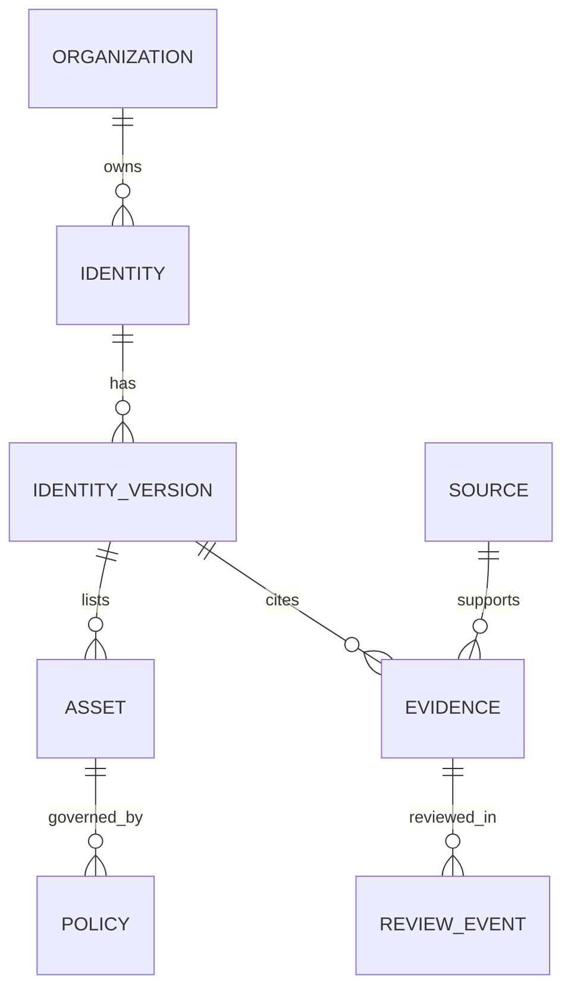

# 운영 데이터 모델과 이식 결정안

이 문서는 **향후 운영 구현을 위한 설계안**입니다. 특정 DB를 설치하거나 운영 마이그레이션을 실행한 결과가 아닙니다. 현재 실행 모델은 `data/catalog.json`의 단일 카탈로그입니다.

## 기본 관계

위 관계는 설계 골격입니다. 정책은 자산뿐 아니라 기관·아이덴티티·버전 범위도 가질 수 있으므로 실제 스키마에서는 대상의 종류와 ID를 명시하거나 각 대상별 연결 테이블을 둡니다.

## 테이블과 책임

| 개체 | 핵심 정보 | 현재 JSON의 대응 | 운영 구현 시 검증할 것 |
| --- | --- | --- | --- |
| Organization | 고유 ID, 공식명, 대표 유형, 국가·지역 | `organization_id`, `organization_name`, `category`, `country`, `region` | 같은 기관의 이름·분류가 서로 충돌하지 않음 |
| Identity | 고유 ID/slug, 기관 ID, 이름, 종류, 검색 별칭 | `id`, `name`, `name_en`, `kind`, `aliases` | 기관 CI·도시 브랜드·서비스 BI를 구분 |
| IdentityVersion | 버전 ID, 상태, 도입일, 근거 | `version` | 현행 여부와 확인일을 분리, 구버전 보존 |
| Asset | 버전 ID, 형태, 안내 형식, 접근 조건, 검증 상태 | `assets[]` | 안내된 형식과 실제 파일 검증을 구분 |
| BinaryInspection | 다운로드 원문, 확인된 형식·바이트·SHA-256·시각 | 현재 asset의 null 메타데이터 | 실제 파일을 받은 후에만 생성 |
| Source | 원문 URL, 게시 주체, 언어, 접근 상태 | `sources.json` | 공식 URL과 검수자의 관측 이력을 보존 |
| Evidence | 대상 필드/범위, source ID, 관측 내용·시각 | 현재 `source_ids`, source observation | 원본 공통 근거를 필드별 증거로 자동 간주하지 않음 |
| Policy | 적용 대상, 목적·조건·승인·재배포·미리보기 근거 | `usage` | 일반 사이트 문구를 모든 로고에 일괄 적용하지 않음 |
| ReviewEvent | 검수자, 이전값/새값, 근거, 상태, 버전 해시 | `review`, 로컬 patch/audit | 입력 검사와 사실 검수·게시 승인 분리 |
| FontRelation | 기관 ID, 실제 LETSUM font ID, 공식 출처 | `related_fonts[]` | 실제 운영 폰트 ID로 대조, 로고 적용 서체와 구분 |
| Suggestion | 제보 내용, 상태, 접수/처리 이력 | 제보 JSON | 개인정보 최소화, 검수 전 공개 금지 |

현재 `aliases`에는 기관·브랜드의 검색 별칭이 함께 들어 있습니다. 운영 분리 시 출처를 대조하고 올바른 대상에 연결합니다. 자동 정규화만으로 기관 별칭과 아이덴티티 별칭을 확정하지 않습니다.

## 권장 공개/운영 분리

공개 응답에는 이름·분류·자료 안내·공식 출처·공개 가능한 확인 범위만 포함합니다. 수정자 계정, 내부 메모, 제보자 연락처, 감사 로그와 미게시 자료는 운영 접근 경로에서만 제공합니다.

현재 정적 빌드는 로컬 검수까지 가능하도록 공개 조사용 시드 전체를 담고 있습니다. 화면에서 draft를 숨기는 것만으로 데이터 비공개를 보장하지 않습니다. 실제 운영에서는 공개/비공개 직렬화를 서버 또는 빌드 단계에서 분리해야 합니다.

## 변경·게시 단계

| 상태 | 의미 | 전환 근거 |
| --- | --- | --- |
| 초안 | 자료/제보를 수집한 단계 | 출처와 형식 입력 |
| 검수 필요 | 내용이 바뀌었거나 확인 미완료 | 변경 사유, 원본 해시 |
| 출처 검토 | 실제 확인 범위 기록 | 검수자·공식 출처·관측 시각 |
| 게시 가능 | 공개 필드와 정책 검토 완료 | 서버 권한 검사와 승인 이벤트 |
| 보관 | 검색 기본 노출에서 제외 | 사유·대체 항목·이력 유지 |

현재 `source-reviewed`는 위 표의 출처 검토에 해당하는 연구 상태입니다. 별도 `published` 승인이 이미 존재한다고 해석하지 않습니다. 운영 상태 머신을 추가하면 현재 enum과의 명시적인 마이그레이션을 작성합니다.

## 이식 시 유지해야 할 검색 의미

- 기관명·브랜드명·영문명·별칭과 초성을 검색합니다.
- 공백으로 나뉜 검색어는 AND입니다.
- 독립된 `AI`, `PNG` 같은 토큰은 안내 형식 조건입니다. `KAI`라는 이름의 일부 `AI`를 형식 필터로 추출하지 않습니다.
- 기관 유형·분야·지역·접근 조건을 독립적으로 조합합니다.
- 동일 기관에 여러 아이덴티티가 있어도 기관 수를 중복 집계하지 않습니다.

## 실제 파일 검증이 추가될 때

형식 표시만으로 `file-verified`를 만들지 않습니다. 권리자가 제공한 원본 파일을 직접 받은 경우에만 저장된 bytes를 기준으로 파일 서명/MIME/확장자 대조, 바이트 수, SHA-256, 검사 시각과 출처를 기록합니다. 검증 성공이 외부 배포 권한을 뜻하지는 않습니다.

제공 주체의 허가 범위가 불명확하면 공식 페이지 링크 안내를 유지합니다. 변환·재색상·재벡터화는 현재 범위에 포함하지 않습니다.
